<!-- Profile README for github.com/chiranjeevbitm — every visual is a hand-built animated SVG in /assets -->

<a href="https://chiranjeev-ai-engineer.vercel.app">
  
</a>

  <a href="#about"><kbd>&nbsp;01 · about&nbsp;</kbd></a>&nbsp;
  <a href="#build"><kbd>&nbsp;02 · how i build&nbsp;</kbd></a>&nbsp;
  <a href="#projects"><kbd>&nbsp;03 · projects&nbsp;</kbd></a>&nbsp;
  <a href="#stack"><kbd>&nbsp;04 · stack&nbsp;</kbd></a>&nbsp;
  <a href="#activity"><kbd>&nbsp;05 · activity&nbsp;</kbd></a>&nbsp;
  <a href="#connect"><kbd>&nbsp;06 · connect&nbsp;</kbd></a>

 

<picture>
  <source media="(prefers-color-scheme: dark)" srcset="assets/h-about-dark.svg">
  
</picture>


I build **production GenAI for enterprises** — retrieval pipelines that stay grounded, multi-agent systems that hand work to each other cleanly, and the MCP plumbing that lets agents use real tools. At **Deloitte** I lead a **GenAI Centre of Excellence**, turning incubator ideas into systems that cut real hours out of real workflows.

Outside work I co-founded **Arogya Sahayak** (clinic digitisation for rural and semi-urban Bihar) and I'm building **[Reel Studio](https://github.com/chiranjeevbitm/reel-studio)**, an open-source pipeline that turns a short brief into a finished vertical explainer reel.

<b>Experience</b> &nbsp;click to expand

 

| | Where | What |
|:-:|:--|:--|
| 🟢 | **Deloitte** — Data Science Consultant · AI/ML Engineer | Lead the GenAI Centre of Excellence: incubator GenAI projects from design to delivery — RAG, agentic systems, MCP — across enterprise clients. |
| ◽ | **Tredence Inc.** | Built scalable data pipelines on Databricks and PySpark. |
| ◽ | **Soroco** | Engineered behavioural analysis models. |
| ◽ | **TCS** | Where it started. |

<b>Certifications</b> &nbsp;click to expand

 

- **NVIDIA** — Certified Agentic AI
- **Microsoft** — Azure AI Engineer Associate · Azure Data Scientist Associate
- **Google Cloud** — Generative AI Leader
- **Anthropic** — Claude Certified Associate, Developer & Architect (Foundations)
- **Kaggle** — Notebooks Expert, top 0.5%

<b>Publications & awards</b> &nbsp;click to expand

 

- 📝 *TLCoV — An automated Covid-19 screening model* · ScienceDirect / Elsevier, 2021
- 🏅 Deloitte Applause Award · Tredence Pat on the Back
- 🎓 CSE, BIT Mesra · MSc Machine Learning & AI, Liverpool John Moores University (Distinction) · IIIT Bangalore

 

<picture>
  <source media="(prefers-color-scheme: dark)" srcset="assets/h-build-dark.svg">
  
</picture>


  

<picture>
  <source media="(prefers-color-scheme: dark)" srcset="assets/h-projects-dark.svg">
  
</picture>

  <a href="https://github.com/chiranjeevbitm/reel-studio"></a>
  <a href="https://github.com/chiranjeevbitm/multimodal_crag"></a>
  <a href="https://github.com/chiranjeevbitm/multi_agentic_chatbot_cRAG"></a>
  <a href="https://github.com/chiranjeevbitm/Leadership-Insight-Agent"></a>
  <a href="https://github.com/chiranjeevbitm/medguardian"></a>
  <a href="https://github.com/chiranjeevbitm/shikshak-Sahayak"></a>

 

<picture>
  <source media="(prefers-color-scheme: dark)" srcset="assets/h-stack-dark.svg">
  
</picture>


<b>Stack as plain text</b> &nbsp;for skimmers and screen readers

 

**GenAI** — LangChain · LangGraph · Azure OpenAI · Claude · MCP · NVIDIA DGX · RAG / CRAG · multi-agent orchestration 
**Data & ML** — Python · PySpark · Databricks · SQL · Pandas · MLflow · Dataiku · Azure AI Search 
**Ship** — Docker · Kubernetes · GitHub Actions · React · TypeScript · Vercel · Playwright

 

<picture>
  <source media="(prefers-color-scheme: dark)" srcset="assets/h-activity-dark.svg">
  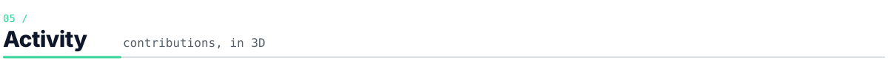
</picture>

<picture>
  <source media="(prefers-color-scheme: dark)" srcset="profile-3d-contrib/profile-3d-dark.svg">
  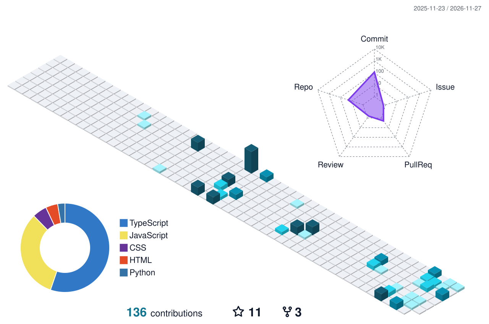
</picture>

  

<picture>
  <source media="(prefers-color-scheme: dark)" srcset="assets/h-connect-dark.svg">
  
</picture>

  
  
  
  

<picture>
  <source media="(prefers-color-scheme: dark)" srcset="assets/footer-dark.svg">
  
</picture>
